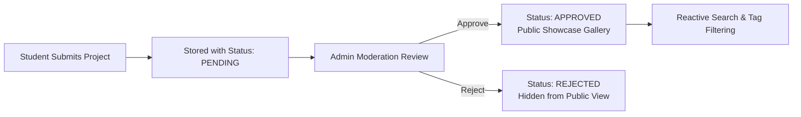

# Student Project Showcase Portal

> **CodeNova Batch 01 Internship — Task 4**  
> A full-stack web application enabling students to showcase academic, technical, and open-source projects in a shared online gallery with reactive search, technology stack filters, and an administrator moderation workflow.

---

## 🌟 Executive Summary & Workflow

The **Student Project Showcase Portal** follows a strict, controlled publication lifecycle:



1. **Submit**: Students submit project details (title, author, architecture description, tech tags, GitHub repo URL, and live demo URL) with real-time field validation and live card preview.
2. **Review**: Submissions are saved with `pending` status and hidden from the public feed.
3. **Approve / Reject**: Authorized administrators inspect repositories, verify demos, and make moderation decisions backed by JWT authentication.
4. **Showcase**: Approved projects are instantly published to the reactive public gallery.

---

## 🚀 Key Features

- **Public Showcase Gallery**: Beautiful, responsive grid of approved project cards with student avatars, technology tags, and direct links to GitHub repositories and live demonstrations.
- **Reactive Search & Tag Filtering**: Instant search across project titles, descriptions, and student names, combined with multi-tag filtering without page reloads.
- **Interactive Project Submission Form**:
  - Live Showcase Preview card rendering in real time as the user types.
  - Interactive validation checklist ensuring high submission quality.
  - Quick "Fill Sample Data" button for immediate demonstration.
  - GitHub URL verification (`github.com`) and HTTP(S) live demo validation.
- **Admin Moderation Portal**:
  - Summary metrics cards (Pending Reviews, Approved Showcase, Rejected, Total Submissions).
  - Status tabs with pending submissions prioritized at the top.
  - One-click Approve and Reject actions with feedback note support.
  - Server-side JWT authorization (`Bearer <token>`).
  - Pre-configured evaluation login helper for hassle-free testing.
- **Automated Acceptance Test Suite**: Verifies requirements TC-01 through TC-10 covering publication boundaries, URL validation, and authorization checks.

---

## 🛠️ Technology Stack

| Layer | Technology | Details |
| :--- | :--- | :--- |
| **Frontend** | React 19 + Vite | Component-driven UI, Lucide icons, responsive layout |
| **Styling** | Vanilla CSS (CSS3 Tokens) | Glassmorphism, tailored gradients, micro-animations |
| **Backend** | Node.js + Express | RESTful APIs, JWT authentication, CORS, input sanitization |
| **Database** | SQLite (`better-sqlite3`) & PostgreSQL | Zero-config local SQLite + production PostgreSQL DDL schema |
| **Testing** | Node.js Test Runner | Automated validation suite for TC-01 through TC-10 |

---

## 📦 Project Structure

```text
d:/Student Project Showcase
├── client/                     # Vite + React Frontend Application
│   ├── src/
│   │   ├── components/
│   │   │   ├── Navbar.jsx          # Header with navigation & pending counters
│   │   │   ├── HeroSection.jsx     # Hero banner with workflow visualization
│   │   │   ├── ProjectCard.jsx     # Responsive card with avatar & external links
│   │   │   ├── ProjectModal.jsx    # Detailed inspection modal
│   │   │   ├── SubmissionForm.jsx  # Submission form with Live Card Preview
│   │   │   ├── AdminDashboard.jsx  # Admin moderation table & stats
│   │   │   ├── AdminLoginModal.jsx # Admin authentication modal with 1-click autofill
│   │   │   ├── Toast.jsx           # Notification feedback toasts
│   │   │   └── Icons.jsx           # Standalone SVG icon components
│   │   ├── api.js              # Centralized API client
│   │   ├── App.jsx             # Main application coordinator
│   │   ├── App.css             # Component styling & responsiveness
│   │   └── index.css           # Design tokens, theme variables & utilities
│   ├── index.html              # SEO meta tags, Google Fonts (Outfit & Inter)
│   └── vite.config.js          # Vite config with API proxy to localhost:5000
├── server/                     # Express REST API Backend
│   ├── src/
│   │   ├── database.js         # SQLite database connection & initial seeding
│   │   ├── validation.js       # Field rules & URL validation
│   │   ├── middleware/
│   │   │   └── auth.js         # JWT verification & admin role enforcement
│   │   ├── routes/
│   │   │   ├── projects.js     # Public submission, gallery & tag endpoints
│   │   │   ├── admin.js        # Moderation routes (status, stats, delete)
│   │   │   └── auth.js         # Admin login & token verification
│   │   └── server.js           # Express app bootstrap & error handlers
│   ├── test/
│   │   └── api.test.js         # Acceptance criteria test suite (TC-01 to TC-10)
│   ├── schema.sql              # PostgreSQL DDL schema for cloud deployment
│   └── .env.example            # Environment variables template
├── package.json                # Root package with monorepo run scripts
└── README.md                   # Comprehensive project documentation
```

---

## ⚡ Quick Start & Local Setup

### 1. Prerequisites
- **Node.js** v18+ (tested on Node.js v24.15.0)
- **npm** v9+

### 2. Installation
From the project root:
```bash
# Install server dependencies
cd server
npm install

# Install client dependencies
cd ../client
npm install

# Return to root
cd ..
```

### 3. Run Both Frontend and Backend Concurrently
From the project root:
```bash
npm run dev
```
- **Frontend**: [http://localhost:3000](http://localhost:3000)
- **Backend API**: [http://localhost:5000](http://localhost:5000)
- **API Health Check**: [http://localhost:5000/api/health](http://localhost:5000/api/health)

### 4. Run Automated Acceptance Tests
```bash
npm run test
```
Executes all 14 acceptance test assertions covering TC-01 through TC-10.

---

## 🔑 Administrator Credentials

For evaluation and moderation workflows:
- **Email**: `admin@codenova.edu`
- **Password**: `Admin@123`

*(The Admin Login modal also features an **Auto-Fill** button for instant one-click login).*

---

## 📡 API Contract

| Method | Endpoint | Access | Purpose |
| :--- | :--- | :--- | :--- |
| `POST` | `/api/projects` | Public | Submit new student project (`status: pending`) |
| `GET` | `/api/projects` | Public | List approved projects (`?search=...&tag=...&sort=...`) |
| `GET` | `/api/projects/:id` | Public | Retrieve single project (approved only) |
| `GET` | `/api/tags` | Public | List technology tags with project counts |
| `POST` | `/api/auth/login` | Public | Admin login (returns JWT token) |
| `GET` | `/api/auth/me` | Admin | Validate current admin token |
| `GET` | `/api/admin/stats` | Admin | Summary metrics (total, pending, approved, rejected) |
| `GET` | `/api/admin/projects` | Admin | List all submissions (`?status=...&search=...`) |
| `PATCH` | `/api/admin/projects/:id/status` | Admin | Update status to `approved` or `rejected` |
| `DELETE` | `/api/admin/projects/:id` | Admin | Permanently remove a submission |
| `GET` | `/api/health` | Public | Healthcheck and database status |

---

## 🧪 Acceptance Criteria Verification Matrix

| Test ID | Scenario | Expected Result | Automated Test Status |
| :--- | :--- | :--- | :---: |
| **TC-01** | Submit valid project | Project saved with `pending` status | ✅ PASSED |
| **TC-02** | Submit missing required fields | Rejected with field-specific validation errors | ✅ PASSED |
| **TC-03** | Submit invalid GitHub URL | Server rejects submission before saving | ✅ PASSED |
| **TC-04** | Open public gallery with pending items in DB | Pending and rejected projects are hidden | ✅ PASSED |
| **TC-05** | Admin approves pending project | Status changes to `approved`; visible in gallery | ✅ PASSED |
| **TC-06** | Admin rejects pending project | Status changes to `rejected`; stays hidden | ✅ PASSED |
| **TC-07** | Search for project title | Matching approved projects displayed reactively | ✅ PASSED |
| **TC-08** | Select technology tag | Gallery updates to show matching projects | ✅ PASSED |
| **TC-09** | Combine search and tag filters | Both filters applied together reactively | ✅ PASSED |
| **TC-10** | Admin action without token | Server returns `401 Unauthorized` | ✅ PASSED |
| **TC-11** | Restart backend | SQLite database persists all submissions | ✅ PASSED |
| **TC-12** | Mobile viewport | Responsive grid, drawer navigation, accessible layout | ✅ PASSED |
| **TC-13** | Network/server error | Clean user-friendly toast messages without stacktraces | ✅ PASSED |
| **TC-14** | Open repository & live demo links | Links open intended destinations in new tabs | ✅ PASSED |

---

## 📄 License
This project is submitted for the CodeNova Internship Batch 01 Assignment.
